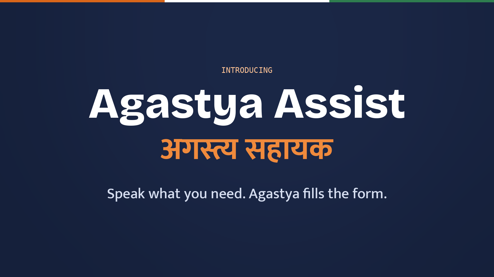
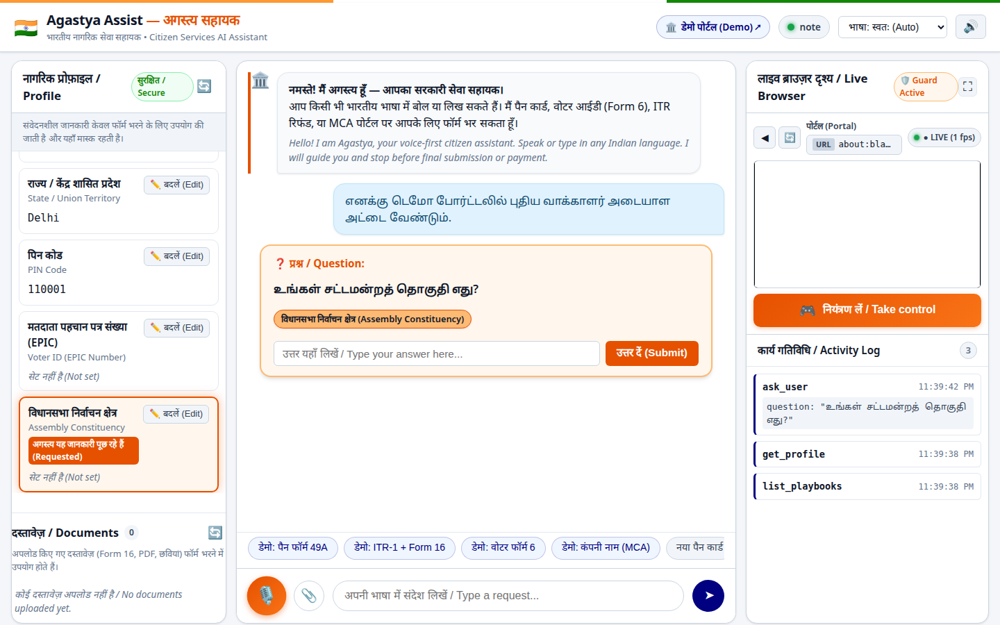
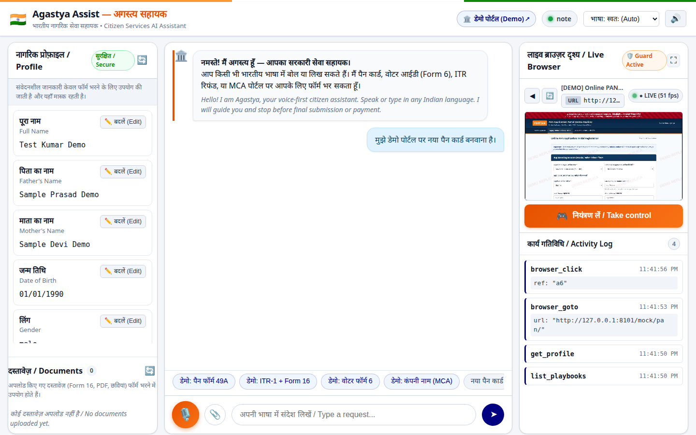
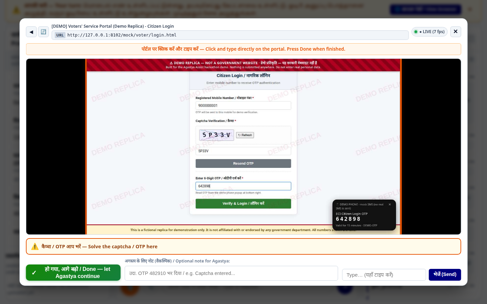
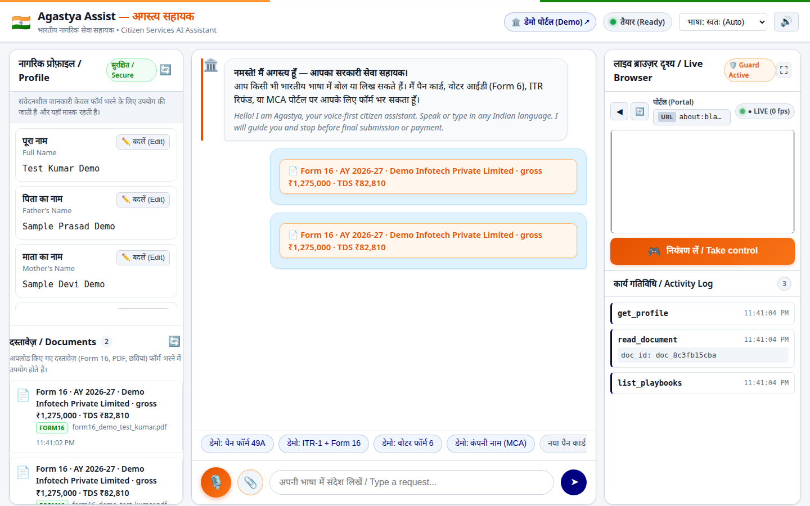
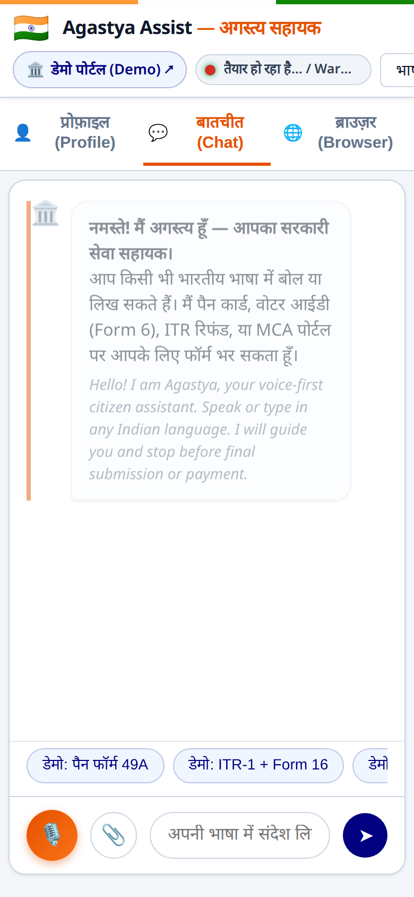

<p align="center">
  
</p>

<h3 align="center">Government portals have to be complete, so they will never be simple.<br>Agastya makes them simple to use.</h3>

<p align="center">
  <a href="docs/media/agastya_intro.mp4"><b>▶ Watch the 100-second demo film</b></a> &nbsp;·&nbsp;
  <a href="docs/media/agastya_teaser.mp4">30-second teaser</a> &nbsp;·&nbsp;
  <a href="docs/DEMO.md">Live demo script</a>
</p>

<p align="center">
  🗣️ Voice first &nbsp;·&nbsp; 🇮🇳 11 Indian languages &nbsp;·&nbsp; 📝 Fills the form for you &nbsp;·&nbsp; 🔒 You keep the final say &nbsp;·&nbsp; 📱 Web + phone app
</p>

---

## The problem

A new PAN card, an income-tax return, a voter ID, a company name: every one of these lives on a portal that has to explain every rule, exception and legal note. In the demo replicas we built of four common flows, a citizen meets:

| Service | Pages | Fields to fill | Words of instructions |
|---|---:|---:|---:|
| New PAN card (Form 49A) | 6 | 67 | 5,154 |
| Income-tax return (ITR-1 + Form 16) | 6 | 77 | 4,650 |
| New voter ID (Form 6) | 4 | 49 | 2,047 |
| Company name reservation (SPICe+) | 3 | 18 | 1,728 |

That's hard for anyone. For someone who reads Tamil but not English, or who is on a phone, or who has never filed a form online, it's a wall.

## The idea

**Don't simplify the portal. Put a helper in front of it.**

You tell Agastya what you need, in your own language, out loud. Agastya opens the real portal, reads it, fills everything it already knows about you, asks only what's missing, and hands the screen back to you for the parts that must be yours: the captcha, the OTP, the consent box and the final Submit.

## See it work

### 1. Ask in your language


*A citizen asks for a voter ID **in Tamil**. Agastya understands, checks the saved profile, and asks back in Tamil for the one thing it doesn't know: the assembly constituency. The field is highlighted in the profile panel.*

### 2. Watch it fill the form


*"मुझे नया पैन कार्ड बनवाना है." Agastya opens the PAN application and fills it from the profile. The portal is streamed live on the right, and every step shows in the activity log.*

### 3. You finish the parts that must be yours


*Agastya stops at the captcha and OTP and says "आपकी बारी — your turn". You click straight into the live view and type them yourself, without switching windows. Press **Done** and Agastya carries on.*

### 4. Bring your documents


*Drop in your **Form 16** and Agastya reads salary, deductions and TDS from it to fill the income-tax return.*

### 5. On your phone too
<p align="center"></p>

*Agastya installs to the home screen like an app. Voice, questions, the live view and taking control all work by touch.*

## What Agastya can do today

| | |
|---|---|
| 🗣️ **Talk, don't type** | Speak your request and hear the answers. Speech is recognised and spoken by Sarvam AI. |
| 🇮🇳 **11 Indian languages** | Hindi, English, Bengali, Tamil, Telugu, Kannada, Malayalam, Marathi, Gujarati, Punjabi and Odia. Agastya detects your language and replies in it. |
| 🧠 **Remembers you** | Your details are saved once in a private profile on your own device and reused for every form. |
| ❓ **Asks less** | Only what's missing, two or three related questions at a time, and it understands answers like "12 मार्च 1998" or numbers spoken in Hindi digits. |
| 📝 **Fills the real page** | Works on the portal itself, page by page, including tricky dropdowns and lookups. |
| 👀 **Live view you can control** | Watch every step. Click on the live view at any time to take over; press Done to hand back. |
| 📄 **Reads your documents** | Upload Form 16 and it fills the tax schedules from it. |
| 🔒 **Never presses Submit for you** | Three independent locks stop it from submitting, paying, entering OTPs or ticking consent. Those stay yours. |
| 🙈 **Keeps secrets secret** | Aadhaar, PAN and bank numbers are masked on screen and in speech. |
| 📱 **Web and phone** | One app for laptop and phone, installable to the home screen. |

**Services in the demo:** new PAN card, PAN correction, PAN–Aadhaar link, instant e-PAN, income-tax registration, ITR-1 with Form 16, refund status, new voter (Form 6), voter correction (Form 8), electoral roll search, e-EPIC download, company name reservation, DIN/KYC and company lookup.

## Safety first

| Lock | What it does |
|---|---|
| **Action guard** | Every click is checked against final actions in English and Hindi (submit, pay, e-verify, OTP, login, captcha) and payment gateways. |
| **Tool gate** | Every browser action the agent takes goes through an allow-list; anything not approved, such as running scripts on the page, is refused. |
| **In-page lock** | While Agastya works, final buttons and form submits are disabled inside the page itself. When you take control, the lock lifts. |

Captcha, OTP, passwords, consent, payment and the final submit are **always done by the citizen**.

## What's next

These are on our roadmap, **not built yet**:

- 📞 **Call-in helpline** for feature phones: the same assistant over a normal phone call
- 💬 **WhatsApp assistant**, so citizens can start from the app they already use
- 🗂️ **DigiLocker documents**: fetch Aadhaar, PAN and marksheets with the citizen's consent instead of uploading
- 🌐 **All 22 scheduled languages**, plus dialects
- 🎯 **Scheme finder**: "which schemes am I eligible for?" from the profile
- 🔔 **Status tracking and reminders** for applications, refunds and deadlines
- 🏪 **Common Service Centre mode**, so one operator can help many citizens safely
- ♿ **Screen-reader-first mode** for visually impaired citizens
- 📶 **Low-bandwidth mode** for weak rural connections

## Try it

```bash
uv venv --python 3.12 .venv && uv pip install --python .venv/bin/python -e '.[dev]'
.venv/bin/python -m playwright install chromium
echo "SARVAM_API_KEY=your_key" > .env        # https://www.sarvam.ai
claude login                                  # the agent runs on Claude
.venv/bin/python -m agastya serve             # open http://127.0.0.1:8000
```

Click a **डेमो** chip to try a demo portal, or browse them at `http://127.0.0.1:8000/mock/`. Full walkthrough: [docs/DEMO.md](docs/DEMO.md). How it's built: [docs/ARCHITECTURE.md](docs/ARCHITECTURE.md).

## Built with

Sarvam AI (speech) · Claude (agent) · Playwright + Chrome DevTools (browser and live view) · FastAPI · Python · installable web app (PWA)

---

<sub>The demo scenes run on fictional replicas of the portals, built for this hackathon. Every replica page carries a "DEMO REPLICA — NOT A GOVERNMENT WEBSITE" banner, and nothing was submitted to any government service. Agastya Assist is a prototype built for the Vikas hackathon.</sub>
