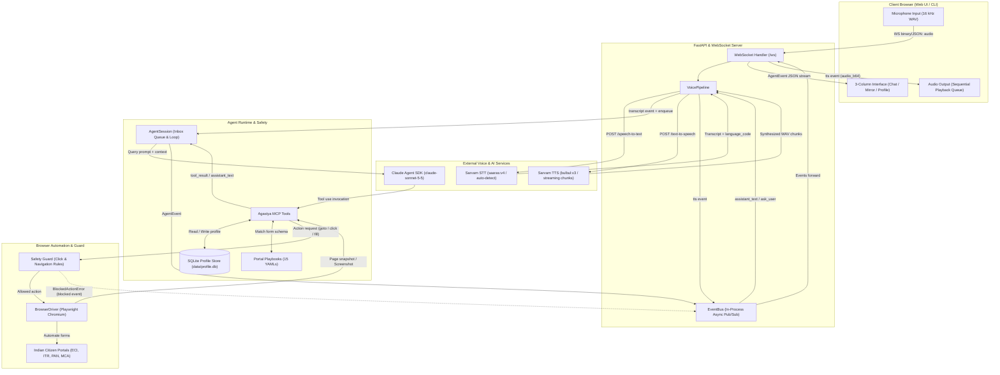

# Agastya Assist — Architecture Documentation

This document describes the system architecture, component interactions, runtime data flow, event system, WebSocket communication protocol, in-process MCP tools, and playbook integration within Agastya Assist.

---

## 1. System Architecture & End-to-End Data Flow

Agastya Assist follows an asynchronous, event-driven architecture connecting browser-based voice I/O with an autonomous Claude agent operating a guarded Playwright browser.



### Data Flow Walkthrough

1. **Audio Capture**: The citizen speaks into the browser microphone. The audio is captured via Web Audio API, downsampled to 16 kHz 16-bit mono PCM WAV, and sent as a base64-encoded payload over WebSocket (`/ws`).
2. **Speech Recognition**: `VoicePipeline` sends the WAV audio to Sarvam AI (`saaras:v4` or `saarika:v2.5`). The API automatically detects the spoken Indian language (e.g., `hi-IN`, `ta-IN`, `bn-IN`) and returns the transcript.
3. **Agent Loop**: The transcript is published as a `transcript` event on the `EventBus` and enqueued into `AgentSession`. Claude (`claude-sonnet-5-5`) evaluates the request against loaded portal playbooks and citizen profile fields.
4. **Tool Execution**: Claude dispatches in-process MCP tools to read the profile (`get_profile`), navigate to portals (`browser_goto`), inspect fields (`browser_snapshot`), and populate form values (`browser_fill`, `browser_select`).
5. **Deterministic Guard Inspection**: Before any click or navigation occurs, `agastya/browser/guard.py` evaluates the target. Irreversible actions (submit, pay, OTP, login, e-verify) are blocked, emitting a `blocked` event and commanding the agent to hand over control to the citizen.
6. **Live Mirror & Voice Feedback**: Every DOM change triggers `browser_screenshot`, streaming visual updates to the web UI. Simultaneously, `VoicePipeline` intercepts agent spoken responses, strips markdown markers, splits them into sentences, synthesizes speech with Sarvam TTS (`bulbul:v3`), and streams `tts` audio chunks for continuous speech playback.

---

## 2. Event System & Event Types

The Agastya runtime coordinates all subsystems using an asynchronous in-process `EventBus`. All events conform to the `AgentEvent` schema:

```python
@dataclass
class AgentEvent:
    type: EventType
    data: dict
    ts: float  # Unix timestamp
```

### Event Catalog

| Event Type | Payload Schema | Description & Trigger |
| :--- | :--- | :--- |
| `status` | `{"status": str, "handoff": bool, "reason": str}` | Agent runtime state changes (`"ready"`, `"warming_up"`, `"thinking"`, `"no_speech"`) or explicit human handoff signal. |
| `assistant_text` | `{"text": str, "language_code": str}` | Agent conversational response meant for the citizen; queued for TTS synthesis. |
| `ask_user` | `{"question_id": str, "question": str, "field": str \| None, "fields": list[str], "language_code": str}` | Agent pauses to ask the citizen for missing required or optional fields. Supports single or grouped field prompts. |
| `tool_call` | `{"name": str, "args": dict}` | Emitted when Claude invokes an MCP tool (e.g. `mcp__agastya__browser_fill`). |
| `tool_result` | `{"name": str, "result": Any, "is_error": bool}` | Result returned by an in-process MCP tool back to the agent. |
| `screenshot` | `{"png_b64": str, "url": str}` | PNG screenshot of the current Playwright page, streamed to mirror panel. |
| `blocked` | `{"action": str, "ref": str, "reason": str, "element": dict}` | Safety guard blocked a forbidden click or navigation (submit, pay, OTP, login). |
| `profile_updated` | `{"field": str, "value": str, "user_id": str}` | Emitted when a field in `data/profile.db` is successfully validated and saved. |
| `error` | `{"error": str}` | Runtime error in agent execution, browser automation, or voice synthesis. |
| `done` | `{"result": Any}` | Query processing completed and agent has concluded active tool turns. |
| `transcript` | `{"text": str, "language_code": str}` | Speech-to-text transcription output emitted after Sarvam STT completes. |
| `tts` | `{"audio_b64": str, "mime": "audio/wav", "text": str, "language_code": str, "seq": int, "final": bool}` | Synthesized sentence audio chunk delivered to client for sequential playback. |

---

## 3. WebSocket Protocol Specification

The web application communicates with the backend via WebSocket on endpoint `/ws?user_id=default`.

### Client to Server Messages

| Message Type | JSON Payload | Description |
| :--- | :--- | :--- |
| `text` | `{"type": "text", "text": "...", "language_code": "hi-IN"}` | Citizen text message typed into chat input. |
| `audio` | `{"type": "audio", "audio_b64": "<base64>", "mime": "audio/wav"}` | 16 kHz 16-bit mono PCM WAV audio recorded from microphone. |
| `answer` | `{"type": "answer", "question_id": "...", "answer": "..."}` | Citizen response answering a pending `ask_user` prompt. |
| `set_language` | `{"type": "set_language", "language_code": "ta-IN"}` | Switches preferred language for agent responses and voice synthesis. |
| `tts` | `{"type": "tts", "enabled": true \| false}` | Toggles automated text-to-speech audio synthesis on/off. |

### Server to Client Messages

Every event emitted on the session `EventBus` is serialized via `event.to_json()` and pushed directly over the WebSocket:

```json
{
  "type": "assistant_text",
  "data": {
    "text": "मैंने आपका नाम और पता फॉर्म में भर दिया है।",
    "language_code": "hi-IN"
  },
  "ts": 1729864200.123
}
```

---

## 4. In-Process MCP Tool Catalog

The Claude Agent SDK interacts with the environment exclusively through an in-process MCP server registered under `mcp__agastya__*`. Built-in Claude Code shell, file, and web tools are strictly disabled.

| Tool Name | Parameters | Return Format | Behavior & Guard Integration |
| :--- | :--- | :--- | :--- |
| `get_profile` | None | `{"fields": {...}}` | Returns all profile fields. Sensitive values (Aadhaar, PAN, Bank) are **masked**. |
| `get_profile_value` | `field: str` | `{"field": str, "value": str}` | Returns the raw, unmasked value for a specific field. Used only to fill form fields. |
| `save_profile_field` | `field: str, value: str` | `{"field": str, "saved": true}` | Validates field against catalog rules, updates SQLite store, emits `profile_updated`. |
| `ask_user` | `question: str, field: str = None, fields: list[str] = []` | `{"answer": str, "saved": {...}, "unparsed": [...]}` | Pauses execution until citizen answers. Automatically extracts pattern fields (PAN, Aadhaar, phone, email, PIN, dates). |
| `list_playbooks` | None | `{"playbooks": [...]}` | Lists all 15 supported government form playbooks with ID, portal name, and titles. |
| `get_playbook` | `id: str` | `{"playbook": {...}}` | Retrieves full playbook specification including required fields, hints, steps, and stop boundaries. |
| `browser_goto` | `url: str` | `PageSnapshot` (url, title, text, fields, actions) | Navigates Playwright page. Checked by `check_navigation()` (blocks payment gateways & logouts). |
| `browser_snapshot` | None | `PageSnapshot` | Injects `data-agastya-ref` tags and returns DOM summary: visible text, input fields, action buttons. |
| `browser_fill` | `ref: str, value: str` | `{"filled": true, "ref": str}` | Fills an `<input>` or `<textarea>` element matching the assigned reference (`f1`, `f2`, etc.). |
| `browser_select` | `ref: str, option: str` | `{"selected": true, "ref": str}` | Selects an option in a `<select>` dropdown by visible text label or option value. |
| `browser_click` | `ref: str` | `PageSnapshot` | Clicks button or link. **Checked by `check_click()`**. If forbidden, raises `BlockedActionError`, emits `blocked` event, and stops agent. |
| `browser_screenshot`| None | `{"screenshot": "captured"}` | Captures viewport PNG screenshot and publishes `screenshot` event with base64 data. |
| `handoff_to_user` | `reason: str` | `{"handoff": true}` | Explicitly halts agent actions, emits `status {"handoff": true}`, and yields control to citizen. |

---

## 5. Browser Safety Guard Architecture

The safety guard (`agastya/browser/guard.py`) enforces strict boundaries to protect citizens:

### Click Inspection (`check_click`)
The guard inspects element attributes (`text`, `aria_label`, `name`, `id`, `value`, `type`, `href`):
1. **Allow Patterns (Priority Override)**: Safe navigation verbs are explicitly allowed (`next`, `continue`, `save draft`, `back`, `previous`, `search`, `select`, `preview`, `download`).
2. **Block Patterns**: Intercepts irreversible actions in both English and Hindi:
   - **Submission**: `submit`, `final submit`, `submit form`, `file return`, `जमा करें`, `जमा करे`.
   - **Payments**: `pay`, `pay now`, `make payment`, `proceed to pay`, `भुगतान`, `भुगतान करें`.
   - **OTP Authentication**: `otp`, `send otp`, `verify otp`, `get otp`, `aadhaar otp`, `ओटीपी`.
   - **Verification**: `verify`, `e-verify`, `proceed to verification`, `सत्यापित करें`, `सत्यापन`.
   - **Authentication**: `login`, `log in`, `sign in`, `logout`, `लॉगिन`, `लॉग इन`.
   - **Captcha**: `captcha refresh`, `reload captcha`, `कैप्चा`.

### Navigation Inspection (`check_navigation`)
Evaluates destination URLs to prevent automated redirects to payment gateways (`paygov`, `billdesk`, `razorpay`, `payu`, `sbiepay`, `ccavenue`, `paytm`) or `/logout` endpoints.

---

## 6. How to Add a New Portal Playbook

Portal playbooks are self-contained YAML specifications stored in `agastya/portals/playbooks/`. Follow these steps to support a new government form:

### Step 1: Create YAML Playbook File
Create `agastya/portals/playbooks/<portal_service_id>.yaml`.

### Step 2: Ensure All 13 Required Keys Are Defined
The loader requires all 13 keys:
- `id`: Unique identifier string (e.g. `epfo_uan_activation`).
- `portal`: Official organization / department name.
- `title_en`: Human-readable English title.
- `title_hi`: Devanagari Hindi title.
- `live_url`: Official government portal URL.
- `fixture`: Relative path to local HTML test fixture (or `null` if none).
- `requires_login`: Boolean indicating if authentication is mandatory before form access.
- `required_fields`: List of canonical fields from `agastya.profile.fields.FIELDS`.
- `optional_fields`: List of optional canonical fields.
- `field_hints`: Mapping of profile field names to substring patterns matching DOM names, IDs, or labels.
- `steps`: Natural-language instructions guiding the agent through form interaction.
- `stop_before`: Button text patterns where automation must stop and trigger hand-off.
- `keywords`: English, Hinglish, and Hindi search keywords for playbook intent matching.

### Step 3: Complete Playbook Example

```yaml
id: "epfo_uan_activation"
portal: "EPFO (Employees' Provident Fund Organisation)"
title_en: "EPFO UAN Activation"
title_hi: "ईपीएफओ यूएएन सक्रियण"
live_url: "https://unifiedportal-mem.epfindia.gov.in/memberinterface/no-auth/uanActivation"
fixture: null
requires_login: false
required_fields:
  - "aadhaar"
  - "full_name"
  - "date_of_birth"
  - "mobile"
optional_fields:
  - "email"
  - "pan"
field_hints:
  aadhaar:
    - "aadhaar"
    - "uid"
    - "aadhaar_no"
  full_name:
    - "member_name"
    - "name"
    - "full_name"
  date_of_birth:
    - "dob"
    - "birth_date"
    - "date_of_birth"
  mobile:
    - "mobile"
    - "phone"
    - "mobile_no"
  email:
    - "email"
    - "email_id"
  pan:
    - "pan"
    - "pan_no"
steps:
  - "Open the EPFO Member Interface UAN activation page."
  - "Fill Member Aadhaar number into the Aadhaar input field."
  - "Enter citizen full name exactly as it appears in Aadhaar records."
  - "Provide date of birth in DD/MM/YYYY format and enter registered mobile number."
  - "Optionally enter email address and PAN if available in profile."
  - "Select the declaration consent checkbox."
  - "Stop before clicking Get Authorization PIN so the user can receive and verify their Aadhaar OTP."
stop_before:
  - "Get Authorization PIN"
  - "Submit"
  - "Send OTP"
  - "Verify"
  - "ओटीपी प्राप्त करें"
  - "सत्यापित करें"
keywords:
  - "uan activate"
  - "activate uan"
  - "epfo uan"
  - "pf uan activation"
  - "pf account activate"
  - "यूएएन एक्टिवेट"
  - "यूएएन सक्रियण"
  - "पीएफ यूएएन एक्टिवेट"
```

### Step 4: Validate Playbook
Run the portal test suite to verify YAML parsing and intent resolution:
```bash
.venv/bin/python -m pytest tests/test_portals.py -q
```
